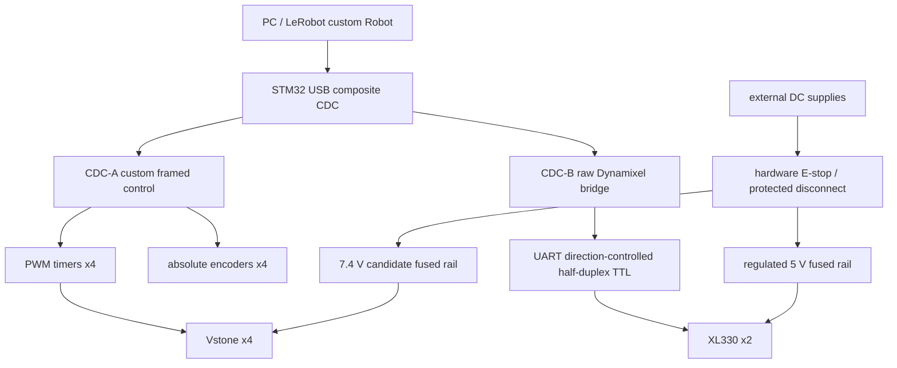

# 電源・通信・制御案

## 推奨候補（Assumption）

STM32 MCUは型番・所有数TBD。タイマ4ch以上、I2CまたはSPI、UART、USB CDCを条件に選ぶ。既存倒立振子PCBの電源・ピン・保護・負荷能力を無条件に流用しない。
CDC-Aは実位置、角度指令、timestamp、sequence、CRC、fault、calibration ID。CDC-BはDYNAMIXEL Protocol 2.0を透過し、LeRobot側DynamixelMotorsBusを直接使える構造を優先。
CDC-Aに独自フレームを被せた単一ポートへDynamixelMotorsBusをそのまま接続できない。USB複合CDCが難しい場合はPC→既存USB DYNAMIXEL adapter + PC→STM32の2ポート案へ切替。adapter所有はUNKNOWN。
半二重はTX buffer三態制御、受信経路、送信完了→方向切替、return delay、echo抑制、タイムアウトを設計。RS-485トランシーバをTTL代用しない。XL330は3.3 V logic/5 V tolerantでSTM32 UARTは3.3 Vを基本とする。VstoneのPWM VIH/周波数/パルス幅はTBD、必要ならbufferを設ける。

## 電源（候補、回路未製作）

Vstone 7.4 V railとXL330 5 V railは別系統、両正極を直結しない。Vstoneの現物が公式候補と一致してから電圧を確定。
信号GNDは電源分配の基準点で接続し、モータ電流の戻り線とMCU/センサ線を分ける。USB GNDをサーボ電流の戻り経路にしない。USBはMCU論理/通信のみ、外部5 VからUSB VBUSへの逆流防止も設計。
非常停止は両モータrailをハードウェア遮断し、MCU観測は維持できる構造を候補にする。切断時にアームが落ちるため受け台・低い作業域・必要なら釣合いばねを用意。PWM停止やDXL torque offだけを非常停止と呼ばない。
分岐fuse、逆接対策、突入/過電流保護、bulk capacitor、過電圧/回生電圧対策、strain reliefが必要。共通上流DC→2つのDC/DCを使う場合は回生吸収・出力間漏れ・共通GNDを確認。

XL330公式：5 V stall current 1.47 A/個。2個同時stallの電源予算は2.94 A +配線/過渡余裕（動かし続けてよい意味ではない）。候補5 V 4 A以上、品質/保護と実負荷波形で決定。
Vstoneのピーク電流は一次情報で確認できずUNKNOWN。I_V >= 4*I_peak_measured*simultaneity + margin。simultaneityを勝手に小さくしない。4台分電源・fuse値の選定はブロック中。
導線はI_peak、長さ、許容温度、端子定格から決定。電圧降下ΔV=2ρLI/A。例は銅0.5 m片道、2 A、0.5 mm²で約0.07 V（端子損失除くAssumption）。具体的AWG/コネクタ/fuse定格は未選定。
XL330はメーカーConnector Informationに従い接点・ピンを確認。PWM用3pinと似ていてもピン互換とみなさない。

## 制御安全（将来仕様）

起動はDISARMED。手動ARM、観測freshness、6軸ID/校正一致、範囲内を条件とする。heartbeat 100 ms切れで新指令拒否・fault latch（仮定）。保持/遮断時の落下を実験前に評価。
MCUでも範囲とslew limitを検査。PC側に同じ制限。透過CDC-Bは任意の書込が通るため、通常運用時のパケットallowlistとwatchdogを設計し、設定モードは別操作にする。
homeは衝突回避経路を通る位置指令で、急にゼロ角へ飛ばさない。終端まで押す自動校正は採用しない。

## 2026-10-11 2軸P1追補

今回はVstone×2、XL330は保持。PC USB VCP→候補NUCLEO-G474RE→PWM2系統と別I2C2系統。既存G474/G431プロジェクトとHAL共通化候補、倒立振子PCBは流用しない。詳細は[electrical_interface](../mechanical/two_joint_prototype/electrical_interface.md)。PWM/電流/保護定格はTBD、実機接続なし。
